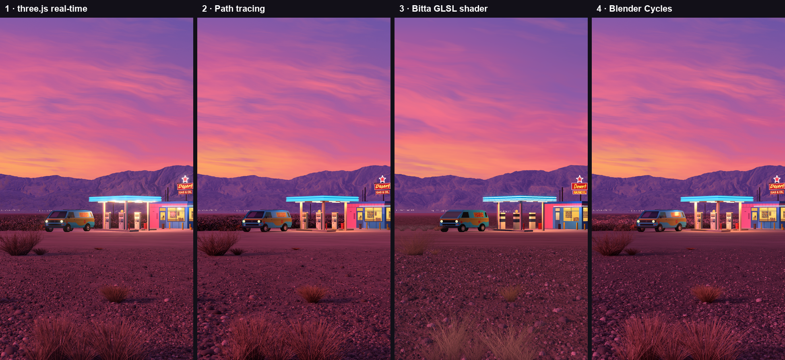

# desert-gas-1to1

A code-only reconstruction of an 11 second dusk gas-station shot. No image, video or model assets: geometry, materials and textures are generated by code. The same composition is rendered four ways so the approaches can be compared.



| # | Method | Entry | Render time for the still |
|---|---|---|---|
| 1 | three.js real-time PBR | `src/realtime.js` | about 6 s including scene build |
| 2 | GPU path tracing (three-gpu-pathtracer) | `src/pathtrace.js` | 283 s, 1200 samples |
| 3 | One GLSL fragment shader | `src/scene.frag.glsl` | 0.7 s |
| 4 | Blender Cycles driven by Python | `src/blender_scene.py` | 23 s, up to 768 samples |

Times measured on an RTX 2080 Ti at 1080x1920 (method 1 at 1440x2560). Methods 1, 2 and 4 share one procedural geometry generator (`src/scene.js`); method 3 is independent. Status: stills only, the animation follows once a method is chosen.

## Reference

The composition follows a clip shared in https://t.me/naxalov/2866. Its original author is unknown and the clip is not included here. Garbled lettering in the clip was replaced with "Desert / GAS & OIL" and the van artwork is an original abstract pattern. `tools/compare.py` and `tools/parallax.py` need local reference frames in `refs/`, which are not distributed.

## Run

```
npm i
node tools/shot.mjs realtime out/1_realtime.png 150 2
SPP=1200 node tools/shot.mjs pathtrace out/2_pathtrace.png 150 1.5 590
ANGLE=gl node tools/shot.mjs shader out/3_shader.png 150 1.5
mkdir -p out/raw/mesh && node tools/shot.mjs exportmesh out/raw/mesh
blender -b --factory-startup -P src/blender_scene.py -- out/raw/mesh out/4_blender.png 150 768 150
```

`tools/shot.mjs` expects Chrome at its default Windows path. Blender 4.5 LTS was used.
